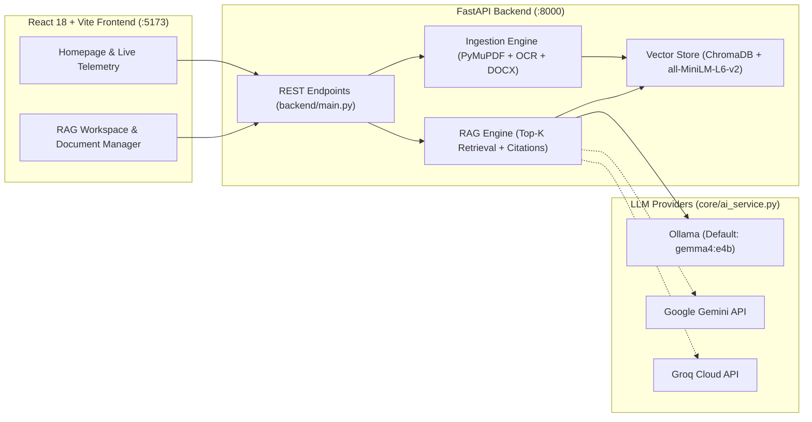
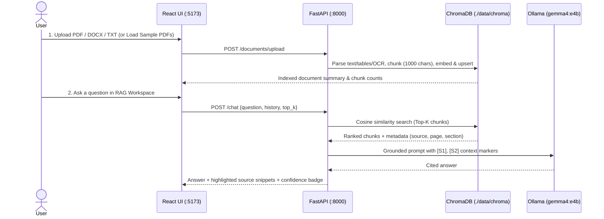

# AI Knowledge Assistant

**AI Knowledge Assistant** is a local-first Retrieval-Augmented Generation (RAG) web application for uploading documents (`.pdf`, `.docx`, `.txt`), indexing them into a persistent local vector database (`ChromaDB`), and asking grounded questions with inline citations and keyword-highlighted source excerpts.

Optimized for **Apple Silicon (`arm64`) macOS** and **Docker Compose**, the project defaults to local **Ollama (`gemma4:e4b`)** inference while also supporting **Google Gemini** and **Groq**.

---

## 📚 Detailed Documentation (`docs/`)

- **[System Architecture](docs/architecture.md)** — High-level system topology, class diagrams, and Apple Silicon + Docker runtime architecture.
- **[Codebase Directory & Symbol Reference](docs/codebase-directory-and-references.md)** — File-by-file directory tree, cross-module call graph, and complete function/class reference.
- **[End-to-End Data Flow](docs/dataflow-end-to-end.md)** — Sequence and decision flowcharts for Document Ingestion and Grounded RAG Question Answering.
- **[Database & Storage Schema](docs/database-schema.md)** — ChromaDB HNSW collection schema, deterministic chunk ID specification, disk layout, and REST payload schemas.
- **[Features, Fixes & Optimizations](docs/features.md)** — Full breakdown of features, resolved backend issues, and macOS performance tuning.

---

## 🏗️ System Architecture Overview



---

## 🔄 End-to-End RAG Workflow



---

## ✨ Key Features

- **Interactive Homepage & RAG Studio**: Dedicated landing page with live system telemetry, 4-stage pipeline overview, one-click sample PDF loader, and a split-pane RAG workspace.
- **Multi-Format Ingestion with Tables & OCR**:
  - **PDF**: Native text extraction + `PyMuPDF` table detection + `Tesseract OCR` fallback for scanned pages.
  - **DOCX**: Heading-aware section grouping + Markdown table extraction.
  - **TXT**: UTF-8 and automatic Latin-1 fallback decoding.
- **Individual Document Management**: View all indexed documents with chunk/page/word counts, delete individual documents (`DELETE /documents/{source}`), or clear the entire collection.
- **Zero-Hallucination Grounding & Highlighting**: Strict system prompting with `[S1]` inline citations, refusal detection, cosine similarity match scores, and automatic keyword highlighting in source excerpts.
- **Apple Silicon & Docker Optimized**: Singleton-cached `all-MiniLM-L6-v2` embeddings, persistent HuggingFace model cache (`./data/hf_cache`), and native Metal GPU acceleration via `host.docker.internal:11434` (`gemma4:e4b`).

---

## 🚀 Quickstart (Docker Compose — Recommended)

### Prerequisites
1. **Docker Desktop** installed and running on your Mac.
2. **Ollama** running locally on your Mac with the `gemma4:e4b` model pulled:
   ```bash
   ollama pull gemma4:e4b
   ```

### 1. Configure Environment
Copy `.env.example` to `.env` (already pre-configured for `ollama` and `gemma4:e4b`):
```bash
cp .env.example .env
```

### 2. Build & Start Services
```bash
docker compose up -d --build
```

### 3. Open the Application
- **Frontend UI (Homepage & RAG Studio)**: `http://localhost:5173`
- **Backend Health Check**: `http://localhost:8000/health`
- **Interactive Swagger API Docs**: `http://localhost:8000/docs`

---

## 💻 Running Natively (Without Docker)

### Terminal 1 — Backend
```bash
python3 -m venv .venv
source .venv/bin/activate
pip install -r requirements.txt
uvicorn backend.main:app --reload --port 8000
```

### Terminal 2 — Frontend
```bash
cd frontend
npm install
npm run dev
```

---

## ⚙️ Environment Variables (`.env`)

| Variable | Default | Description |
| :--- | :--- | :--- |
| `LLM_PROVIDER` | `ollama` | Active LLM provider: `ollama`, `gemini`, or `groq` |
| `OLLAMA_BASE_URL` | `http://localhost:11434` | Local Ollama URL (automatically overridden to `http://host.docker.internal:11434` in Docker) |
| `OLLAMA_MODEL` | `gemma4:e4b` | Default Ollama model used for RAG generation |
| `GEMINI_API_KEY` | *(empty)* | API key when `LLM_PROVIDER=gemini` |
| `GEMINI_MODEL` | `gemini-flash-latest` | Gemini model identifier |
| `GROQ_API_KEY` | *(empty)* | API key when `LLM_PROVIDER=groq` |
| `GROQ_MODEL` | `llama-3.3-70b-versatile` | Groq model identifier |
| `RAG_TOP_K` | `5` | Default number of chunks retrieved per query |
| `CHUNK_SIZE` | `1000` | Maximum character length per chunk |
| `CHUNK_OVERLAP` | `150` | Character overlap between consecutive chunks |
| `CHROMA_PERSIST_DIR` | `data/chroma` | Local directory for ChromaDB storage |
| `UPLOAD_DIR` | `data/uploads` | Local directory for uploaded files |

---

## 🔌 REST API Reference

| Method | Endpoint | Description |
| :--- | :--- | :--- |
| `GET` | `/health` | Returns service health, active `provider`, `model`, `stored_chunks`, and indexed `documents`. |
| `GET` | `/documents` | Lists all indexed documents with chunk, page, section, and word counts. |
| `POST` | `/documents/upload` | Uploads and indexes one or more `.pdf`, `.docx`, or `.txt` files. |
| `POST` | `/documents/sample` | Indexes the bundled sample PDFs from `Sample_doc/`. |
| `DELETE` | `/documents/{source_name}` | Deletes a specific document and its chunks from ChromaDB and disk. |
| `POST` | `/documents/clear` | Clears the entire ChromaDB collection and uploaded files. |
| `POST` | `/chat` | Answers a user question grounded in retrieved chunks with citations and highlighted snippets. |
