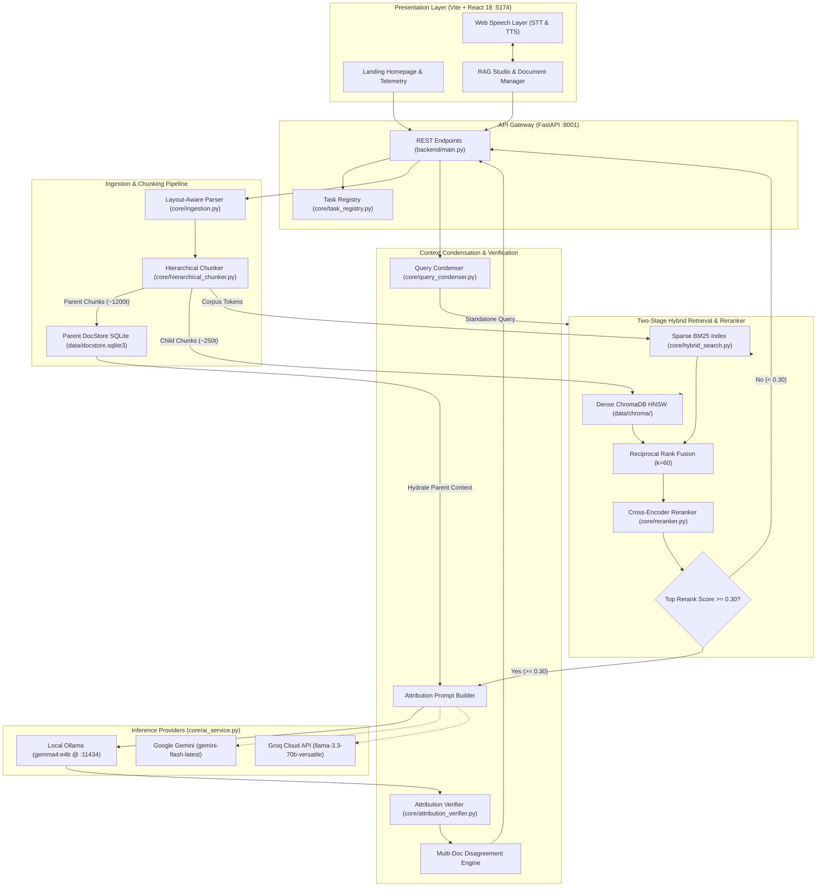
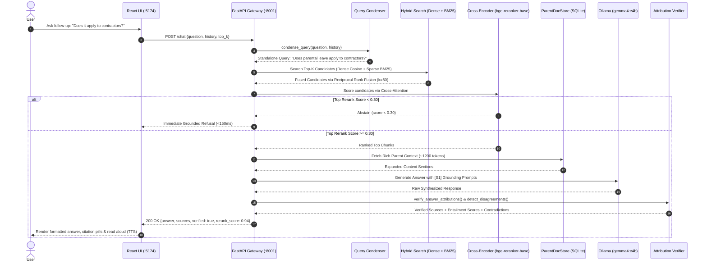

# AI Knowledge Assistant (Production RAG Studio)

[](https://www.python.org/)
[](https://fastapi.tiangolo.com/)
[](https://react.dev/)
[](https://www.typescriptlang.org/)
[](https://www.trychroma.com/)
[](https://ollama.com/)
[-8A2BE2)](https://ollama.com/)
[](#-testing--verification)
[](LICENSE)

An enterprise-grade, local-first **Retrieval-Augmented Generation (RAG) Studio** engineered to ingest complex, multi-page corporate documents (`.pdf`, `.docx`, `.txt`) and deliver **zero-hallucination, evidence-backed answers** with sentence-level entailment verification, deterministic abstention, and hands-free voice interaction.

Optimized for **Apple Silicon (`arm64`) Metal GPU acceleration** and **Docker Compose**, the platform defaults to local **Ollama (`gemma4:e4b`)** inference while offering seamless cloud fallbacks to **Google Gemini** and **Groq**.

---

## 📚 Deep-Dive Documentation Index (`docs/`)

Explore the comprehensive technical documentation suite:

| Document | Description |
| :--- | :--- |
| **[System Architecture](docs/architecture.md)** | Full system topology, class diagrams, dual-storage model, and Apple Silicon Metal runtime. |
| **[Codebase Directory & Symbol Reference](docs/codebase-directory-and-references.md)** | Directory tree, cross-module call graph, and complete function/symbol reference across backend & frontend. |
| **[End-to-End Data Flow](docs/dataflow-end-to-end.md)** | Detailed Mermaid sequence diagrams for Asynchronous Ingestion and Grounded Hybrid RAG Answering. |
| **[Database & Storage Schema](docs/database-schema.md)** | ChromaDB HNSW collection, SQLite `ParentDocStore` schema, ER diagram, and chunk ID specs. |
| **[Features & Optimizations](docs/features.md)** | Complete feature breakdown, architectural flaw resolutions, and macOS performance benchmarks. |
| **[Production Specification (`SPEC-RAG-2026-V2`)](docs/production-rag-system.spec.md)** | Formal RFC engineering specification, EARS functional requirements, and evaluation gates. |
| **[Interview Guide](docs/interview-guide.md)** | Comprehensive technical interview explainer with 25+ architectural Q&As and whiteboard breakdowns. |

---

## 🏗️ System Architecture Topology



---

## 🔄 End-to-End Grounded RAG Dataflow



---

## ✨ Production Architectural Highlights

| Feature | Legacy Naive RAG | Production AI Knowledge Assistant |
| :--- | :--- | :--- |
| **Ingestion Concurrency** | Synchronous HTTP blocking main event loop; crashes on >20MB PDFs | **Decoupled Asynchronous Background Worker** with `job_id` returned in <50ms & live progress polling |
| **PDF Layout & Tables** | Naive string dump; multi-column bleed; tables flattened into whitespace | **PyMuPDF Bounding-Box Geometry Sorting** + true GitHub-Flavored Markdown table extraction |
| **Chunking Strategy** | Fixed 1000-character chunks (sacrifices context or precision) | **Hierarchical Parent-Child Chunking**: 250t leaf chunks for ANN search + 1200t parent for LLM context |
| **Retrieval Architecture** | Pure vector cosine similarity; blind to acronyms and alphanumeric codes | **Two-Stage Hybrid Search**: Dense ChromaDB + Inverted BM25Okapi fused with RRF ($k=60$) |
| **False-Positive Filtering** | None; LLMs hallucinate answers on out-of-scope questions | **Cross-Encoder Reranking** (`bge-reranker-base`) with **Deterministic Abstention Gate** ($\tau < 0.30$) |
| **Conversational Context** | Searches raw query strings; breaks on pronouns (*"Does it apply to him?"*) | **Few-Shot Context Condenser** rephrasing conversational turns into standalone retrieval queries |
| **Attribution & Hallucination** | Blind belief in LLM bracket outputs | **Two-Tier Sentence NLI Judge** checking numerical overlap + **Multi-Doc Disagreement Engine** |
| **Multimodal Interaction** | Keyboard text input only | **Hands-Free Voice Layer** using browser Web Speech API for both STT input and clean TTS audio output |
| **Port Isolation** | Conflicted with NewsLens-AI on 8000/5173 | **Dedicated Non-Conflicting Ports**: Backend on `8001`, Frontend on `5174` |

---

## 🚀 Quickstart Guide

### System Requirements
- **OS:** macOS (Apple Silicon M1/M2/M3/M4 recommended) or Linux.
- **Python:** 3.12+ (or Docker Engine).
- **Node.js:** 18+ (for frontend).
- **Ollama:** Installed and running locally:
  ```bash
  ollama pull gemma4:e4b
  ```

---

### Option A: Local Native Execution (Fastest for Development)

#### 1. Setup Backend
```bash
# Clone the repository
git clone https://github.com/Piyushgoel99/AI-Knowledge-Assistant.git
cd AI-Knowledge-Assistant

# Create virtual environment and install dependencies
python3 -m venv .venv
source .venv/bin/activate
pip install -r requirements.txt

# Start backend on dedicated port 8001
PYTHONPATH=. uvicorn backend.main:app --host 0.0.0.0 --port 8001 --reload
```

#### 2. Setup Frontend
```bash
# In a new terminal window
cd frontend
npm install
npm run dev
```

#### 3. Access Application
- **Frontend Studio:** [http://localhost:5174](http://localhost:5174)
- **Backend Health:** [http://localhost:8001/health](http://localhost:8001/health)
- **Swagger OpenAPI Docs:** [http://localhost:8001/docs](http://localhost:8001/docs)

---

### Option B: Docker Compose Execution

```bash
# Copy pre-configured environment file
cp .env.example .env

# Build and launch isolated containers
docker compose up -d --build

# View real-time container logs
docker compose logs -f
```

---

## 🧪 Testing & Verification

The project enforces strict Test-Driven Development (TDD) with high-seam unit and integration tests across all pipeline layers.

```bash
# Run the complete test suite (24 tests)
PYTHONPATH=. .venv/bin/pytest -v tests/
```

```text
tests/integration/test_async_ingestion.py::test_upload_returns_202_accepted_with_job_id PASSED
tests/integration/test_async_ingestion.py::test_get_task_status_lifecycle PASSED
tests/integration/test_async_ingestion.py::test_get_nonexistent_task_returns_404 PASSED
tests/integration/test_voice_and_disagreement_api.py::test_chat_endpoint_returns_extended_attribution_contracts PASSED
tests/integration/test_voice_and_disagreement_api.py::test_chat_endpoint_abstention_fast_path PASSED
tests/unit/test_attribution_verifier.py::test_verify_claim_entailment_verified PASSED
tests/unit/test_attribution_verifier.py::test_verify_claim_entailment_unverified_hallucination PASSED
tests/unit/test_attribution_verifier.py::test_detect_multi_document_disagreement PASSED
tests/unit/test_attribution_verifier.py::test_answer_question_enriches_sources_with_verification PASSED
tests/unit/test_hierarchical_chunker.py::test_hierarchical_chunker_splits_into_parent_and_child_chunks PASSED
tests/unit/test_hierarchical_chunker.py::test_parent_docstore_crud PASSED
tests/unit/test_hybrid_search.py::test_rrf_scoring_algorithm PASSED
tests/unit/test_hybrid_search.py::test_bm25_exact_token_matching PASSED
tests/unit/test_layout_parser.py::test_markdown_table_formatting PASSED
tests/unit/test_layout_parser.py::test_column_sorting_preserves_reading_order PASSED
tests/unit/test_layout_parser.py::test_prune_headers_footers PASSED
tests/unit/test_query_condenser.py::test_condense_query_without_history_returns_verbatim PASSED
tests/unit/test_query_condenser.py::test_condense_query_with_history_calls_llm_few_shot PASSED
tests/unit/test_query_condenser.py::test_condense_query_cleans_llm_output PASSED
tests/unit/test_query_condenser.py::test_answer_question_uses_condensed_query_for_retrieval PASSED
tests/unit/test_reranker_and_abstention.py::test_sigmoid_math PASSED
tests/unit/test_reranker_and_abstention.py::test_reranker_scores_and_orders_chunks PASSED
tests/unit/test_reranker_and_abstention.py::test_abstention_gate_triggers_when_top_score_below_threshold PASSED
tests/unit/test_reranker_and_abstention.py::test_answer_question_deterministic_refusal_fast_path PASSED

======================== 24 passed in 5.25s ========================
```

To test the frontend TypeScript build:
```bash
cd frontend && npm run build
```

---

## 🔌 Complete REST API Reference

| Method | Endpoint | Description | Status Code |
| :--- | :--- | :--- | :--- |
| `GET` | `/health` | Service health, model info, chunk counters, and indexed document inventory. | `200 OK` |
| `POST` | `/documents/upload` | Asynchronous multi-file upload (`.pdf`, `.docx`, `.txt`). Returns `job_id`. | `202 Accepted` |
| `GET` | `/documents/tasks/{job_id}` | Polling endpoint returning stage, percentage, processed pages, and status. | `200 OK` |
| `POST` | `/documents/sample` | One-click loader for bundled sample documents in `Sample_doc/`. | `200 OK` |
| `GET` | `/documents` | Detailed list of all indexed documents with page, chunk, and word metrics. | `200 OK` |
| `DELETE` | `/documents/{source_name}`| Completely purges a specific document from ChromaDB, SQLite, and disk. | `200 OK` |
| `POST` | `/documents/clear` | Purges the entire vector store, SQLite docstore, and upload cache. | `200 OK` |
| `POST` | `/chat` | Grounded RAG answering with query condensation, reranking, and entailment audit. | `200 OK` |

---

## 🛠️ Configuration Options (`.env`)

| Variable | Default | Purpose |
| :--- | :--- | :--- |
| `BACKEND_PORT` | `8001` | Dedicated FastAPI port (isolates from 8000) |
| `FRONTEND_PORT` | `5174` | Dedicated Vite UI port (isolates from 5173) |
| `LLM_PROVIDER` | `ollama` | Active LLM backend: `ollama`, `gemini`, or `groq` |
| `OLLAMA_BASE_URL`| `http://localhost:11434` | Ollama connection endpoint |
| `OLLAMA_MODEL` | `gemma4:e4b` | Default high-efficiency local Apple Silicon model |
| `GEMINI_API_KEY` | *(empty)* | Optional Google Gemini API key |
| `GROQ_API_KEY` | *(empty)* | Optional Groq Cloud API key |
| `RAG_TOP_K` | `5` | Retrieved chunks per query |
| `CHROMA_PERSIST_DIR` | `data/chroma` | Persistent ChromaDB storage path |
| `UPLOAD_DIR` | `data/uploads` | Document upload directory |

---

## 📄 License

This project is licensed under the MIT License — see the [LICENSE](LICENSE) file for details.
