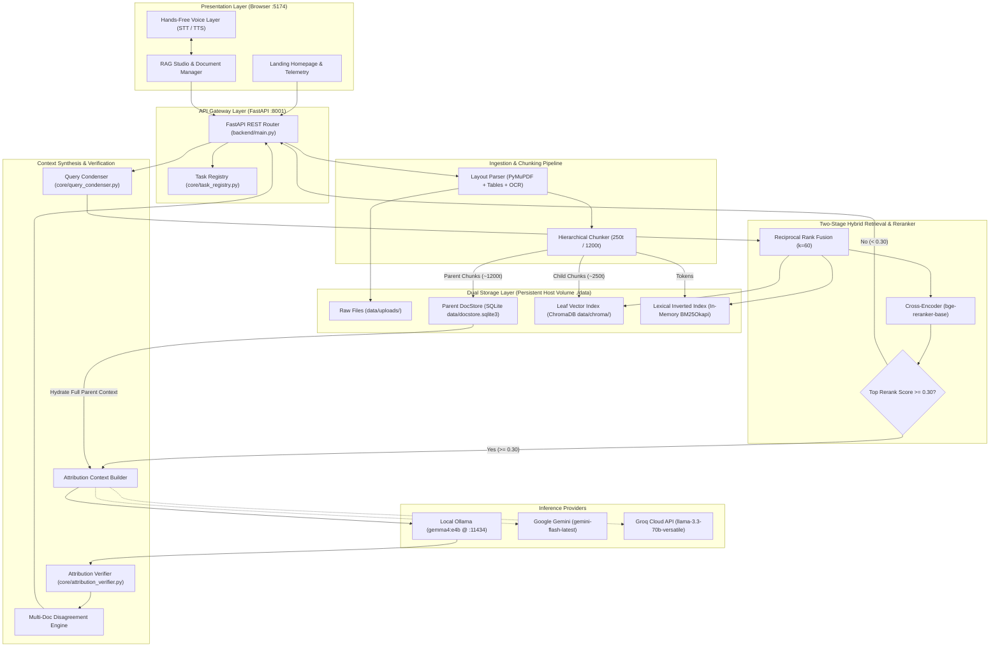
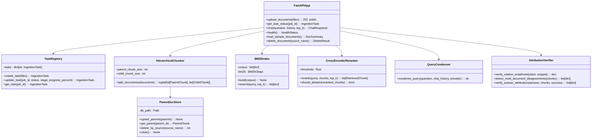

# System Architecture

This document provides a comprehensive architectural blueprint of the **AI Knowledge Assistant**, an enterprise-grade, local-first Retrieval-Augmented Generation (RAG) platform engineered for zero-hallucination document question answering and optimized for Apple Silicon (`arm64`) macOS and Docker environments.

---

## 1. High-Level System Topology

The system is structured into five decoupled layers operating across dedicated ports to prevent collision with other developer services (such as NewsLens-AI on ports 8000/5173):

1. **Presentation Layer (`frontend/` @ Port 5174)**: React 18 + TypeScript + Vite single-page application featuring:
   - Dedicated Landing Homepage with real-time health telemetry and pipeline showcases.
   - Split-Pane RAG Studio Workspace with live file upload progress bars, dynamic chunk sliders, and verified source cards.
   - Hands-Free Voice Layer utilizing browser Web Speech API for real-time speech-to-text (STT) and synthesized read-aloud (TTS).
   - System Architecture Blueprint visualizer.
2. **API Gateway & Task Coordination Layer (`backend/` @ Port 8001)**: FastAPI + Uvicorn server providing:
   - Non-blocking asynchronous file ingestion returning `job_id` within <50ms.
   - Real-time task progress monitoring endpoint (`GET /documents/tasks/{job_id}`).
   - Grounded conversational chat endpoints (`POST /chat`) with multi-document disagreement tracking.
   - Document lifecycle management (`/documents/sample`, `/documents/{source_name}`, `/documents/clear`).
3. **Core Ingestion & Dual-Storage Engine (`core/`)**:
   - **Layout-Aware Ingestion (`core/ingestion.py`)**: PyMuPDF bounding-box geometry sorting preventing cross-column reading bleed, GFM table extraction, running header/footer pruning, and Tesseract OCR fallback for scanned pages.
   - **Hierarchical Chunking & Parent DocStore (`core/hierarchical_chunker.py`)**: Dual-tier chunker generating 1200-token parent sections stored in SQLite (`data/docstore.sqlite3`) and 250-token leaf child chunks indexed in ChromaDB (`data/chroma/`).
4. **Two-Stage Hybrid Retrieval & Reranker Engine (`core/`)**:
   - **Hybrid Retrieval (`core/hybrid_search.py` + `core/vector_store.py`)**: High-dimensional dense vector retrieval (`EmbeddingGemma-2` 768d via Ollama, with `all-MiniLM-L6-v2` fallback) fused with sparse inverted BM25Okapi lexical matching via Reciprocal Rank Fusion ($k=60$).
   - **Cross-Encoder Reranker & Refusal Gate (`core/reranker.py`)**: Precision cross-attention scoring (`BAAI/bge-reranker-base`) with a deterministic refusal gate bypassing LLM generation when top score $< \tau = 0.30$.
5. **Attribution, Synthesis & Inference Layer (`core/`)**:
   - **Context-Aware Query Condenser (`core/query_condenser.py`)**: Standalone retrieval query rewriter resolving follow-up pronouns and ellipsis.
   - **Attribution & Disagreement Verifier (`core/attribution_verifier.py`)**: Post-generation sentence-to-snippet NLI entailment judge and multi-document policy contradiction detector.
   - **LLM Provider Adapter (`core/ai_service.py`)**: Local-first inference adapter defaulting to **Ollama (`gemma4:e4b`)** with zero cloud egress cost, plus pluggable support for **Google Gemini** and **Groq**.



---

## 2. Core Module Class & Component Design



---

## 3. Dedicated Port Mapping & Network Isolation

To eliminate port collision with other local developer tools (notably NewsLens-AI on ports 8000 and 5173), the AI Knowledge Assistant runs on dedicated non-conflicting ports:

| Service | Host Port | Container Port | Purpose |
| :--- | :--- | :--- | :--- |
| **Vite Frontend UI** | `5174` | `5174` | User interface, RAG studio, and Web Speech audio controls |
| **FastAPI Backend** | `8001` | `8000` | REST API, background workers, and ChromaDB/SQLite storage |
| **Ollama Inference** | `11434` | `11434` | Host Apple Silicon Metal GPU runtime |

---

## 4. Apple Silicon (`arm64`) & Metal GPU Optimization

The architecture is tailored specifically for macOS on Apple Silicon (M1/M2/M3/M4):
- **Unified Memory Sharing**: Ollama models (`gemma4:e4b`) run natively on macOS Metal GPU using unified memory with zero PCI-e transfer penalty.
- **`keep_alive: 30m` Session Retention**: Prevents Ollama from evicting weights from RAM between questions.
- **Fast SentenceTransformers Embeddings**: ChromaDB runs `EmbeddingGemma-2` (768d) via host Ollama GPU acceleration or local SentenceTransformers fallback with `OMP_NUM_THREADS=4` and `TOKENIZERS_PARALLELISM=false`, maintaining sub-20ms embedding times per query.
- **Fast Refusal Gating**: Out-of-scope questions are trapped by `CrossEncoderReranker.should_abstain()` and refused in <150ms without invoking the LLM.

---

## 5. Embedding Model & Vector Database Architecture

### 5.1 Embedding Model Analysis: `EmbeddingGemma-2` vs `all-MiniLM-L6-v2`

| Dimension | `all-MiniLM-L6-v2` (Legacy) | `EmbeddingGemma-2` (Active Default) | Architectural Advantage |
| :--- | :--- | :--- | :--- |
| **Origin & Model Family** | BERT / SentenceTransformers (2021) | Google DeepMind Gemma 2/3 (2025/2026) | State-of-the-art representation learning foundation |
| **Parameter Count** | ~22.7M parameters | ~300M parameters | 13x parameter capacity for nuanced semantic capture |
| **Embedding Dimensions** | 384 dimensions | **768 dimensions** (Matryoshka support) | 2x dense dimensionality, capturing subtle domain relationships |
| **Max Context Window** | **256 tokens** (~1,000 chars) | **2,048 to 8,192 tokens** | **Eliminates silent token truncation** on multi-paragraph chunks |
| **Vocabulary & Tokenizer** | 30k WordPiece (English-biased) | 256k Gemma Tokenizer | Native code, mathematical symbols, and multilingual tokens |
| **MTEB Benchmark Score** | ~56.3 avg retrieval | **~64.5 - 68.2 avg retrieval** | Substantially higher precision across dense retrieval benchmarks |
| **Host Runtime** | In-container CPU PyTorch | **Ollama via Apple Silicon Metal GPU** | Zero Python memory overhead; GPU-accelerated embedding inference |

### 5.2 Vector Database Analysis: ChromaDB vs Alternatives

| Capability | In-Process ChromaDB (Current Default) | Qdrant (Alternative / Cloud Scale) | pgvector (PostgreSQL) |
| :--- | :--- | :--- | :--- |
| **Deployment Footprint** | Embedded SQLite + HNSWlib (`data/chroma`) | External container / Rust daemon (`:6333`) | PostgreSQL extension |
| **Infrastructure Overhead** | **Zero external containers required** | Requires Docker service management | Requires managed PostgreSQL database |
| **Collection Dimension Immutability** | Fixed per collection (requires versioning) | Fixed per collection | Alter table column |
| **Native Hybrid Search** | No (requires custom BM25 + RRF layer) | **Yes (Native dense + sparse SPLADE/BM25)** | Requires pg_trgm + vector index queries |
| **Concurrent Write Locks** | SQLite table lock contention under heavy write | ACID MVCC concurrent write pipelines | Full ACID transactional isolation |
| **Best Used For** | Local-first desktop RAG studio, zero-config setups | Multi-tenant SaaS, high write QPS, large catalogs | Enterprise systems with existing Postgres schemas |

### 5.3 Dynamic Dimension-Safe Collection Versioning

ChromaDB enforces strict vector dimensionality checks at runtime. If a collection created with 384 dimensions receives a 768-dimensional vector, ChromaDB throws an unrecoverable `ValueError`.

To guarantee non-destructive model switching without manual database wipes, the vector store implements **dynamic collection versioning**:

```python
def get_default_collection_name(config: AppConfig | None = None) -> str:
    cfg = _resolve_config(config)
    if cfg.chroma_collection_name:
        return cfg.chroma_collection_name
    safe_model = cfg.embedding_model.lower().replace(":", "_").replace("-", "_")
    return f"ai_knowledge_{safe_model}"
```

- When `EMBEDDING_MODEL=embeddinggemma-2`, vectors route to `ai_knowledge_embeddinggemma_2` (768-dim).
- When `EMBEDDING_MODEL=all-MiniLM-L6-v2`, vectors route to `ai_knowledge_all_minilm_l6_v2` (384-dim).
- Neither collection interferes with or invalidates the other, enabling zero-downtime model experimentation.
