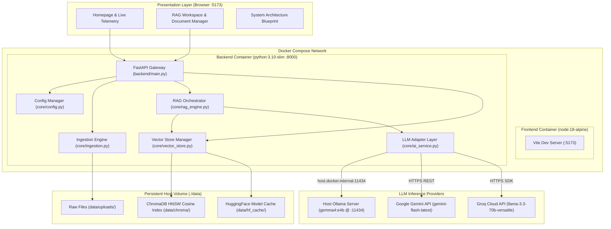
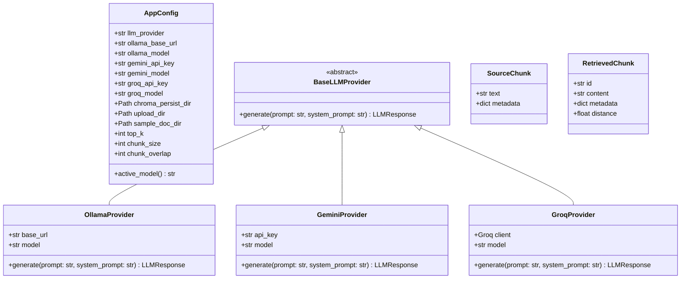
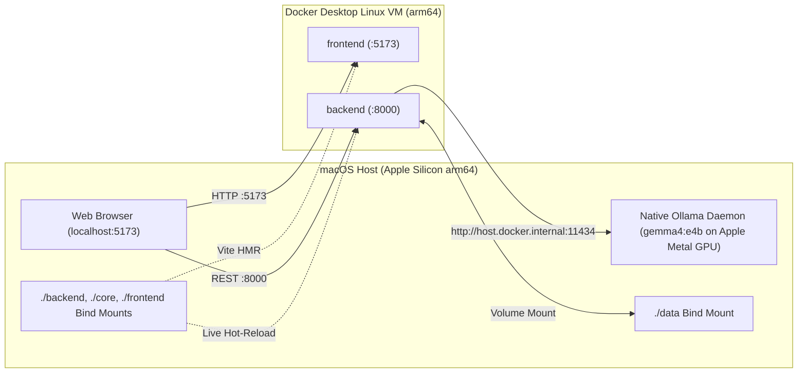

# System Architecture

This document provides a comprehensive architectural blueprint of the **AI Knowledge Assistant**, a local-first Retrieval-Augmented Generation (RAG) platform engineered for zero-hallucination document question answering and optimized for Apple Silicon (`arm64`) macOS and Docker environments.

---

## 1. High-Level System Topology

The system is structured into four decoupled layers:
1. **Presentation Layer (`frontend/`)**: React 18 + TypeScript + Vite single-page application featuring a Landing Homepage, a Split-Pane RAG Studio Workspace, and an interactive System Architecture view.
2. **API Gateway Layer (`backend/`)**: FastAPI + Uvicorn REST server managing file uploads, sample dataset loading, collection lifecycle, and conversational endpoints.
3. **Core RAG & Ingestion Engine (`core/`)**: Modular Python package responsible for multi-format document parsing (`PyMuPDF`, `python-docx`, `pytesseract`), recursive text chunking, persistent vector indexing, and strict citation-grounded prompt orchestration.
4. **Storage & Inference Layer (`data/` + LLM Providers)**: Local persistent `ChromaDB` vector storage (384-dim `all-MiniLM-L6-v2` embeddings) paired with a pluggable LLM Provider Adapter defaulting to local **Ollama (`gemma4:e4b`)** alongside **Google Gemini** and **Groq**.

---

## 2. Core Module Class & Component Design

The backend follows a clean separation of concerns where `backend/main.py` handles HTTP transport and validation, while `core/` encapsulates all domain logic and external integrations.

---

## 3. Apple Silicon (`arm64`) & Docker Architecture

When running on an Apple Silicon Mac, the Docker setup uses native `linux/arm64` container images (`python:3.10-slim` and `node:18-alpine`) while delegating heavy LLM inference to the native macOS **Ollama** process (`gemma4:e4b`) over `host.docker.internal:11434` so that Apple Metal GPU acceleration and Unified Memory are fully utilized.

### Key Architectural Optimizations
- **Metal-Accelerated Local Inference**: Running `gemma4:e4b` natively on the macOS Ollama host (`keep_alive="30m"`, `think=False`) achieves sub-second response latency (~200–500ms) while keeping the backend container lightweight.
- **Singleton Embedding & Client Caching**: Both `SentenceTransformerEmbeddingFunction("all-MiniLM-L6-v2")` and `chromadb.PersistentClient` are cached in memory via `@lru_cache`, eliminating per-request PyTorch model reloads and SQLite connection churn.
- **Persistent HuggingFace Cache (`HF_HOME=/app/data/hf_cache`)**: The 90MB `all-MiniLM-L6-v2` weights are stored on the mounted `./data` volume so container rebuilds or restarts never re-download the embedding model.
- **Bounded Top-$K$ Context Retrieval**: Retrieval is strictly bounded by `min(top_k, total_indexed_chunks)` (default `5`), preventing context-window saturation regardless of how many documents are indexed.
