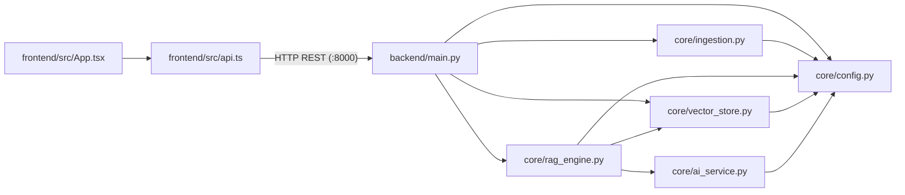

# Codebase Directory & Symbol Reference

This document maps every directory, file, class, and function in the **AI Knowledge Assistant** repository.

---

## 1. Repository Directory Structure

```text
AI-Knowledge-Assistant/
├── backend/
│   ├── __init__.py
│   └── main.py                              # FastAPI application & REST route handlers
├── core/
│   ├── __init__.py
│   ├── ai_service.py                        # LLM adapter layer (Ollama, Gemini, Groq)
│   ├── config.py                            # Environment configuration & defaults
│   ├── ingestion.py                         # PDF/DOCX/TXT extraction, tables, OCR, chunking
│   ├── rag_engine.py                        # Retrieval, prompt building, citation & highlighting
│   └── vector_store.py                      # ChromaDB persistent client, indexing & search
├── frontend/
│   ├── Dockerfile.frontend                  # Node 18 Alpine container definition for Vite
│   ├── .dockerignore                        # Excludes node_modules and dist from Docker context
│   ├── .env.example                         # Example frontend environment config
│   ├── index.html                           # Root HTML shell with Inter & JetBrains Mono fonts
│   ├── package.json                         # Frontend dependencies & npm scripts
│   ├── tsconfig.json                        # TypeScript compiler configuration
│   ├── vite.config.ts                       # Vite dev server configuration (:5173)
│   └── src/
│       ├── App.tsx                          # Homepage, RAG Workspace, and Architecture UI
│       ├── api.ts                           # Typed fetch client for all backend endpoints
│       ├── main.tsx                         # React DOM root mount
│       ├── styles.css                       # Responsive CSS design system
│       └── vite-env.d.ts                    # Vite TypeScript ambient declarations
├── Sample_doc/
│   ├── JD - Data Quality Assurance.pdf      # Bundled sample PDF for testing RAG
│   └── JD- Software Developer.pdf           # Bundled sample PDF for testing RAG
├── docs/
│   ├── architecture.md                      # System topology & Apple Silicon architecture
│   ├── codebase-directory-and-references.md # Complete file and symbol reference
│   ├── dataflow-end-to-end.md               # Ingestion & RAG query sequence diagrams
│   ├── database-schema.md                   # ChromaDB collection, chunk ID & metadata schema
│   └── features.md                          # Feature catalog, bug fixes & optimizations
├── data/                                    # Runtime persistent volume (git-ignored)
│   ├── chroma/                              # Persistent ChromaDB SQLite + HNSW segments
│   ├── hf_cache/                            # Cached SentenceTransformer model weights
│   └── uploads/                             # Uploaded source files (.pdf, .docx, .txt)
├── .dockerignore                            # Root Docker build context exclusions
├── .env.example                             # Template environment variables (default: gemma4:e4b)
├── .gitignore                               # Git ignore rules
├── Dockerfile.backend                       # Python 3.10-slim + Tesseract OCR backend image
├── docker-compose.yml                       # Multi-container orchestration with live bind mounts
├── requirements.txt                         # Python package dependencies
└── README.md                                # Project overview & quickstart guide
```

---

## 2. Cross-Module Dependency Graph



---

## 3. Detailed Module & Symbol Reference

### 3.1 `backend/main.py` — FastAPI Gateway

| Symbol | Type | Description |
| :--- | :--- | :--- |
| `app` | `FastAPI` | Main ASGI application instance configured with CORS middleware for `localhost:5173` and `127.0.0.1:5173`. |
| `ChatRequest` | `BaseModel` | Request schema for `POST /chat`: `question: str`, `history: list[dict]`, `top_k: int \| None`. |
| `health()` | `GET /health` | Returns service status, active `provider`, active `model` (`gemma4:e4b`), `stored_chunks`, `document_count`, and indexed `documents` list. |
| `get_documents()` | `GET /documents` | Lists all unique documents indexed in ChromaDB along with chunk, page, section, and word counts. |
| `upload_documents(files)` | `POST /documents/upload` | Saves uploaded `.pdf`, `.docx`, and `.txt` files to `data/uploads/`, extracts chunks via `ingest_file()`, and upserts them into ChromaDB. |
| `load_sample_documents()` | `POST /documents/sample` | Copies and indexes the bundled PDFs from `Sample_doc/` into the knowledge base for instant one-click testing. |
| `remove_document(source_name)` | `DELETE /documents/{source_name}` | Deletes all chunks belonging to `source_name` from ChromaDB and removes the file from `data/uploads/`. |
| `chat(request)` | `POST /chat` | Converts request history into `ChatMessage` objects and invokes `answer_question()`. Maps provider errors to HTTP `502`. |
| `clear_documents()` | `POST /documents/clear` | Drops and recreates the ChromaDB collection and deletes all uploaded files in `data/uploads/`. |

---

### 3.2 `core/config.py` — Runtime Configuration

| Symbol | Type | Description |
| :--- | :--- | :--- |
| `AppConfig` | `@dataclass(frozen=True)` | Immutable configuration container holding provider settings, storage paths, `top_k`, `chunk_size`, and `chunk_overlap`. |
| `AppConfig.active_model` | `@property -> str` | Resolves the active model name (`ollama_model`, `gemini_model`, or `groq_model`) based on `llm_provider`. |
| `load_config()` | `() -> AppConfig` | Reads environment variables with defaults: `LLM_PROVIDER=ollama`, `OLLAMA_MODEL=gemma4:e4b`, `RAG_TOP_K=5`, `CHUNK_SIZE=1000`, `CHUNK_OVERLAP=150`. |

---

### 3.3 `core/ai_service.py` — LLM Provider Adapter Layer

| Symbol | Type | Description |
| :--- | :--- | :--- |
| `LLMResponse` | `@dataclass(frozen=True)` | Standardized wrapper containing `text: str` and `raw: Any \| None`. |
| `BaseLLMProvider` | `ABC` | Abstract base class requiring `generate(prompt, system_prompt) -> LLMResponse`. |
| `OllamaProvider` | `BaseLLMProvider` | Calls `POST {base_url}/api/generate` using a pooled `requests.Session` with `keep_alive="30m"`, `think=False`, and `temperature=0.1`. |
| `GeminiProvider` | `BaseLLMProvider` | Calls Google Gemini REST endpoint `v1beta/models/{model}:generateContent` with `systemInstruction`. |
| `GroqProvider` | `BaseLLMProvider` | Calls Groq `client.chat.completions.create()` for cloud inference. |
| `create_llm_provider(config)` | `Factory Function` | Instantiates the configured `BaseLLMProvider` implementation. |
| `_strip_thinking_tags(text)` | `Helper Function` | Strips any `<think>...</think>` reasoning blocks from model outputs before citation parsing. |

---

### 3.4 `core/ingestion.py` — Document Parsing & Chunking

| Symbol | Type | Description |
| :--- | :--- | :--- |
| `SourceChunk` | `@dataclass(frozen=True)` | Intermediate extracted text unit with `text: str` and `metadata: dict`. |
| `is_supported_file(file_path)` | `(str \| Path) -> bool` | Checks whether the file extension is in `{".pdf", ".docx", ".txt"}`. |
| `ingest_file(file_path, config)` | `(str \| Path) -> list[Document]` | Extracts raw sections/pages and splits them with `RecursiveCharacterTextSplitter`. Adds `chunk_index`, `chunk_count`, `char_count`, and `word_count`. |
| `_extract_pdf_chunks(path)` | `(Path) -> list[SourceChunk]` | Extracts page text via `pymupdf`, extracts tables via `page.find_tables()`, and runs safe `pytesseract` OCR fallback for scanned image pages. |
| `_extract_docx_chunks(path)` | `(Path) -> list[SourceChunk]` | Groups paragraphs under Word heading styles (`Heading 1`, etc.) and converts DOCX tables into pipe-delimited Markdown tables. |
| `_extract_txt_chunks(path)` | `(Path) -> list[SourceChunk]` | Reads plain text files with UTF-8 and automatic `latin-1` fallback. |

---

### 3.5 `core/vector_store.py` — Persistent ChromaDB Operations

| Symbol | Type | Description |
| :--- | :--- | :--- |
| `RetrievedChunk` | `@dataclass(frozen=True)` | Represents a retrieved chunk (`id`, `content`, `metadata`, `distance`). |
| `_get_embedding_function()` | `@lru_cache(maxsize=1)` | Singleton `SentenceTransformerEmbeddingFunction("all-MiniLM-L6-v2")`. |
| `_get_cached_client(path)` | `@lru_cache(maxsize=4)` | Singleton `chromadb.PersistentClient` per resolved storage directory. |
| `get_collection(name, config)` | `Function` | Gets or creates the `ai_knowledge_assistant` collection with `{"hnsw:space": "cosine"}`. |
| `add_documents(documents, ...)` | `Function` | Deduplicates existing chunks for any re-uploaded `source` filename, then upserts chunks with SHA-1 suffixed deterministic IDs. |
| `search_documents(query, top_k)` | `Function` | Performs cosine similarity vector search bounded by `min(top_k, collection.count())`. |
| `list_indexed_documents(...)` | `Function` | Aggregates chunk metadata by `source` to report per-file chunk count, page count, section count, and word count. |
| `delete_document(source_name)` | `Function` | Deletes all chunks matching `where={"source": source_name}`. |
| `clear_collection(...)` | `Function` | Deletes and recreates the ChromaDB collection empty. |

---

### 3.6 `core/rag_engine.py` — Grounded RAG Orchestrator

| Symbol | Type | Description |
| :--- | :--- | :--- |
| `ChatMessage` | `@dataclass(frozen=True)` | Conversation turn with `role` and `content`. |
| `answer_question(...)` | `Function` | Orchestrates retrieval, prompt construction, LLM generation, refusal detection, citation extraction (`[S1]`, `[S2]`), and snippet highlighting. |
| `_extract_and_highlight_match` | `Function` | Identifies sentences in cited chunks that share keywords with the generated answer and wraps matching terms in `**bold**` markers. |
| `_is_refusal_response(text)` | `Function` | Detects when the LLM refuses to answer due to missing context. |

---

### 3.7 `frontend/src/` — React TypeScript UI

| File | Key Exports / Responsibilities |
| :--- | :--- |
| `frontend/src/api.ts` | Exports `getHealth()`, `uploadDocuments()`, `loadSampleDocuments()`, `deleteDocument()`, `clearDocuments()`, and `askQuestion()`, plus TypeScript types `Source`, `IndexedDocument`, `HealthStatus`, and `ChatMessage`. |
| `frontend/src/App.tsx` | Implements the 3-view navigation (`Home`, `RAG Workspace`, `System Architecture`), live telemetry cards, file uploader, sample PDF loader, per-document deletion list, `top_k` tuning slider, and citation/highlight renderer. |
| `frontend/src/styles.css` | Complete design system with CSS custom properties, responsive grid layouts, citation pills, confidence badges, and highlighted source cards. |
