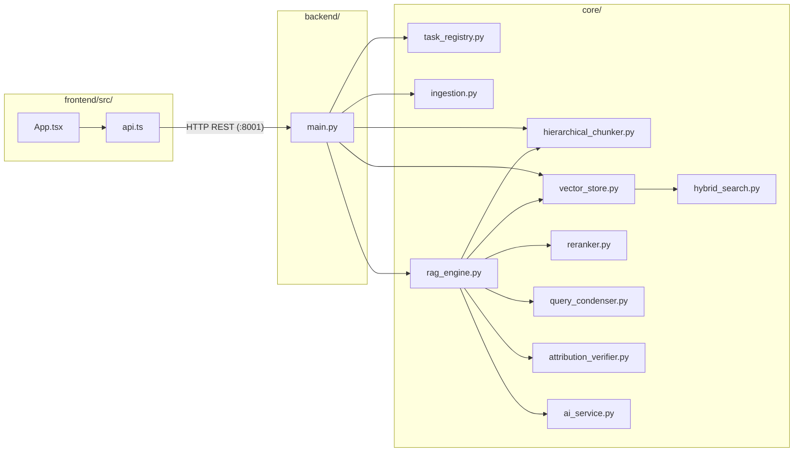

# Codebase Directory & Symbol Reference

This document maps every directory, file, class, and function in the **AI Knowledge Assistant** repository.

---

## 1. Repository Directory Structure

```text
AI-Knowledge-Assistant/
├── backend/
│   ├── __init__.py
│   └── main.py                              # FastAPI router, background workers & REST endpoints
├── core/
│   ├── __init__.py
│   ├── ai_service.py                        # Pluggable LLM adapters (Ollama, Gemini, Groq)
│   ├── attribution_verifier.py              # Sentence entailment judge & multi-doc disagreement engine
│   ├── config.py                            # Pydantic/dataclass configuration & environment loader
│   ├── hierarchical_chunker.py              # Parent-child chunker & SQLite docstore persistence
│   ├── hybrid_search.py                     # BM25Okapi lexical index & Reciprocal Rank Fusion (k=60)
│   ├── ingestion.py                         # PyMuPDF column sorting, Markdown table extractor & OCR
│   ├── query_condenser.py                   # Conversational pronoun & ellipsis context rewriter
│   ├── reranker.py                          # Cross-encoder reranking & deterministic refusal gate
│   ├── task_registry.py                     # In-memory background ingestion task lifecycle manager
│   └── vector_store.py                      # ChromaDB persistent collection, hybrid search & deduplication
├── frontend/
│   ├── Dockerfile.frontend                  # Container definition for Vite dev server (:5174)
│   ├── .env.example                         # Pre-configured frontend environment variables
│   ├── index.html                           # Root HTML shell with Inter & JetBrains Mono fonts
│   ├── package.json                         # Node dependencies & npm scripts
│   ├── tsconfig.json                        # TypeScript compiler options
│   ├── vite.config.ts                       # Vite server configuration (port 5174)
│   └── src/
│       ├── App.tsx                          # Full React UI: Homepage, RAG Studio & Voice Layer
│       ├── api.ts                           # Typed REST API client & response contracts
│       ├── main.tsx                         # React 18 DOM mount
│       ├── styles.css                       # Design system, animations & responsive styling
│       └── vite-env.d.ts                    # TypeScript ambient declarations
├── Sample_doc/
│   ├── JD - Data Quality Assurance.pdf      # Bundled sample document for quickstart testing
│   └── JD- Software Developer.pdf           # Bundled sample document for quickstart testing
├── docs/
│   ├── architecture.md                      # High-level system topology & Apple Silicon Metal runtime
│   ├── codebase-directory-and-references.md # Complete codebase tree & API symbol dictionary
│   ├── database-schema.md                   # ChromaDB collection, SQLite docstore & ER diagrams
│   ├── dataflow-end-to-end.md               # End-to-end sequence diagrams for ingestion & RAG
│   ├── features.md                          # Production features, resolved issues & benchmarks
│   ├── interview-guide.md                   # Technical interview preparation & architectural Q&A
│   ├── production-rag-system.spec.md        # Formal RFC specification (SPEC-RAG-2026-V2)
│   └── archify/                             # Interactive architectural diagram artifacts
├── tests/
│   ├── integration/
│   │   ├── test_async_ingestion.py          # Asynchronous upload & polling lifecycle tests
│   │   └── test_voice_and_disagreement_api.py # Voice layer & disagreement contract tests
│   └── unit/
│       ├── test_attribution_verifier.py     # Sentence entailment & contradiction unit tests
│       ├── test_hierarchical_chunker.py     # Parent/child chunking & SQLite docstore tests
│       ├── test_hybrid_search.py            # BM25Okapi exact matching & RRF fusion tests
│       ├── test_layout_parser.py            # Multi-column sorting & table formatting tests
│       ├── test_query_condenser.py          # Pronoun resolution & few-shot condensation tests
│       └── test_reranker_and_abstention.py  # Cross-encoder scoring & abstention gate tests
├── .scratch/
│   └── tickets/                             # Vertical tracer-bullet ticket specs (TICK-001 to 008)
├── data/                                    # Persistent local volume (git-ignored)
│   ├── chroma/                              # Persistent ChromaDB HNSW binary segment store
│   ├── docstore.sqlite3                     # SQLite parent document store
│   ├── hf_cache/                            # Cached SentenceTransformer & reranker weights
│   └── uploads/                             # Saved source files (.pdf, .docx, .txt)
├── Dockerfile.backend                       # Python 3.10-slim + Tesseract OCR backend container
├── docker-compose.yml                       # Docker Compose definition with live host bind mounts
├── Makefile                                 # Fast developer CLI workflow commands
├── requirements.txt                         # Python dependencies
└── README.md                                # Project overview, quickstart & REST API reference
```

---

## 2. Cross-Module Call Graph



---

## 3. Symbol Reference & Class Dictionary

### `core/task_registry.py`
- `class IngestionTask`: Data structure tracking `job_id`, `status`, `stage`, `progress_percent`, `processed_pages`, `total_pages`, `stored_chunks`, and `error`.
- `class TaskRegistry`: In-memory thread-safe registry.
  - `create_task(files: list[str]) -> IngestionTask`: Initializes job in `queued` state.
  - `update_task(job_id: str, ...) -> IngestionTask`: Updates progress and active pipeline stage.
  - `get_task(job_id: str) -> IngestionTask | None`: Retrieves current task status.

### `core/hierarchical_chunker.py`
- `class ParentChunk`: Represents rich 1200-token semantic section with metadata.
- `class ChildChunk`: Represents compact 250-token leaf chunk referencing `parent_id`.
- `class ParentDocStore`: SQLite-backed persistent document store (`data/docstore.sqlite3`).
  - `upsert_parents(parents: Sequence[ParentChunk]) -> None`: Persists parent chunks.
  - `get_parent(parent_id: str) -> ParentChunk | None`: Fetches parent chunk by ID.
  - `delete_by_source(source_name: str) -> int`: Purges parent chunks for deleted documents.
- `class HierarchicalChunker`:
  - `split_documents(documents: Sequence[Document]) -> tuple[list[ParentChunk], list[Document]]`: Splits raw documents into parent and child chunk pairs.

### `core/hybrid_search.py`
- `reciprocal_rank_fusion(rank_lists: Sequence[Sequence[str]], k: int = 60) -> list[tuple[str, float]]`: Combines ranked candidate ID lists using Reciprocal Rank Fusion.
- `class BM25Index`: In-memory lexical inverted index.
  - `build(corpus: list[dict[str, Any]]) -> None`: Tokenizes chunk texts and constructs BM25Okapi instance.
  - `search(query: str, top_k: int = 5) -> list[dict[str, Any]]`: Performs lexical keyword search.

### `core/reranker.py`
- `sigmoid(x: float) -> float`: Numerically stable sigmoid function.
- `class CrossEncoderReranker`:
  - `rerank(query: str, chunks: Sequence[RetrievedChunk], top_k: int | None = None) -> list[RetrievedChunk]`: Scores query-chunk pairs with cross-attention and populates `rerank_score`.
  - `should_abstain(reranked_chunks: Sequence[RetrievedChunk], threshold: float | None = None) -> bool`: Flags abstention if top rerank score falls below threshold $\tau = 0.30$.

### `core/query_condenser.py`
- `condense_query(question: str, chat_history: Sequence[object] | None, provider: BaseLLMProvider | None) -> str`: Rephrases conversational follow-up turns referencing pronouns or ellipsis into standalone retrieval queries.

### `core/attribution_verifier.py`
- `verify_citation_entailment(claim: str, snippet: str, threshold: float = 0.35) -> dict[str, Any]`: Verifies token overlap and strict numerical consistency between asserted claims and cited source excerpts.
- `detect_multi_document_disagreements(chunks: Sequence[RetrievedChunk]) -> list[dict[str, Any]]`: Identifies conflicting metrics, numbers, or policies across different documents.
- `verify_answer_attributions(answer_text: str, chunks: Sequence[RetrievedChunk], sources: list[dict[str, Any]]) -> list[dict[str, Any]]`: Enriches sources with verification status (`verified: true/false`).

### `core/ingestion.py`
- `sort_blocks_by_column(blocks: list[tuple]) -> list[tuple]`: Clusters text blocks by horizontal bounding box coordinates before reading order sorting to prevent cross-column text bleed.
- `format_markdown_table(table_data: list[list[str | None]]) -> str`: Converts 2D cell matrices into clean GitHub-Flavored Markdown tables.
- `prune_headers_footers(blocks: list[tuple], page_rect: pymupdf.Rect) -> list[tuple]`: Filters out running headers and footers based on vertical page margins.
- `ingest_file(file_path: Path, config: AppConfig) -> list[Document]`: Main entrypoint parsing PDF, DOCX, and TXT files.

### `core/rag_engine.py`
- `answer_question(question: str, chat_history: Sequence[ChatMessage] | None, top_k: int | None, ...) -> dict[str, Any]`: Orchestrates query condensation, hybrid retrieval, cross-encoder reranking, abstention gating, parent context hydration, LLM generation, sentence entailment verification, and contradiction reporting.
