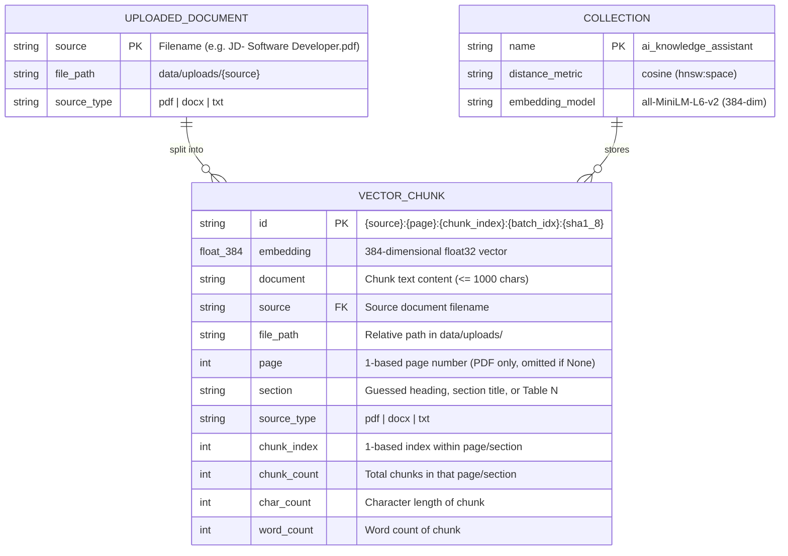
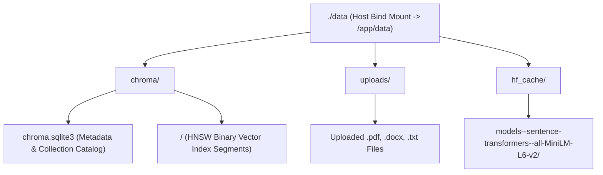

# Database & Storage Schema

The **AI Knowledge Assistant** uses a zero-cloud, local persistent storage architecture backed by **ChromaDB** (`data/chroma/`), raw file storage (`data/uploads/`), and a persistent HuggingFace model cache (`data/hf_cache/`).

---

## 1. Storage Architecture & Entity Relationships

Although ChromaDB is a document-oriented vector database rather than a traditional relational RDBMS, chunks within the `ai_knowledge_assistant` collection follow a strict logical schema linking uploaded files, extracted sections/pages, and vector embeddings.



---

## 2. ChromaDB Collection Specification

| Property | Value | Description |
| :--- | :--- | :--- |
| **Client Type** | `chromadb.PersistentClient` | Embedded SQLite + local HNSW binary segment storage |
| **Persistence Path** | `data/chroma/` | Mapped to `/app/data/chroma` inside Docker via `./data:/app/data` |
| **Collection Name** | `ai_knowledge_assistant` | Default collection name (`DEFAULT_COLLECTION_NAME`) |
| **Embedding Model** | `all-MiniLM-L6-v2` | Sentence-Transformers model producing 384-dimensional normalized vectors |
| **Distance Metric** | `cosine` (`{"hnsw:space": "cosine"}`) | Cosine distance $d \in [0, 2]$; converted to similarity score $s = \max(0, 1 - d)$ |

---

## 3. Deterministic Chunk ID Format

Each chunk stored in ChromaDB is assigned a deterministic primary key (`id`) generated by `_build_chunk_id()` in `core/vector_store.py`:

```text
{source}:{page}:{chunk_index}:{batch_index}:{sha1_prefix}
```

**Example:**
```text
JD- Software Developer.pdf:1:1:1:a94f2c1b
```

- **`source`**: Original filename (`JD- Software Developer.pdf`)
- **`page`**: Page number (`1` for PDFs, `na` for DOCX/TXT)
- **`chunk_index`**: 1-based chunk index within that page or section
- **`batch_index`**: 1-based position in the ingestion batch
- **`sha1_prefix`**: First 8 hex characters of `SHA-1(page_content)`

> [!NOTE]
> When a file with the same `source` name is uploaded again, `add_documents()` first executes `collection.delete(where={"source": source_name})` before upserting the new chunks. This guarantees zero stale or duplicate chunks across re-uploads.

---

## 4. Physical On-Disk Directory Layout (`./data`)



---

## 5. REST API Payload Schemas

### 5.1 `GET /health` Response
```json
{
  "status": "ok",
  "provider": "ollama",
  "model": "gemma4:e4b",
  "stored_chunks": 6,
  "document_count": 2,
  "documents": [
    {
      "source": "JD - Data Quality Assurance.pdf",
      "source_type": "PDF",
      "chunks": 3,
      "page_count": 2,
      "section_count": 2,
      "total_words": 342
    }
  ]
}
```

### 5.2 `POST /chat` Request & Response
**Request:**
```json
{
  "question": "What skills are required for the Software Developer role?",
  "history": [
    { "role": "user", "content": "Hello" },
    { "role": "assistant", "content": "How can I help with your documents?" }
  ],
  "top_k": 5
}
```

**Response:**
```json
{
  "answer": "The Software Developer role requires proficiency in Python and modern web frameworks [S1].",
  "sources": [
    {
      "source": "JD- Software Developer.pdf",
      "page": 1,
      "section": "Job Description: Software Developer",
      "snippet": "...requires **proficiency** in **Python** and **modern** **frameworks**...",
      "chunk_id": "JD- Software Developer.pdf:1:1:1:8f3d2a10",
      "distance": 0.312,
      "similarity": 0.688,
      "cite_index": 1
    }
  ],
  "confidence": "high",
  "refusal": false,
  "model": "gemma4:e4b",
  "provider": "ollama"
}
```
