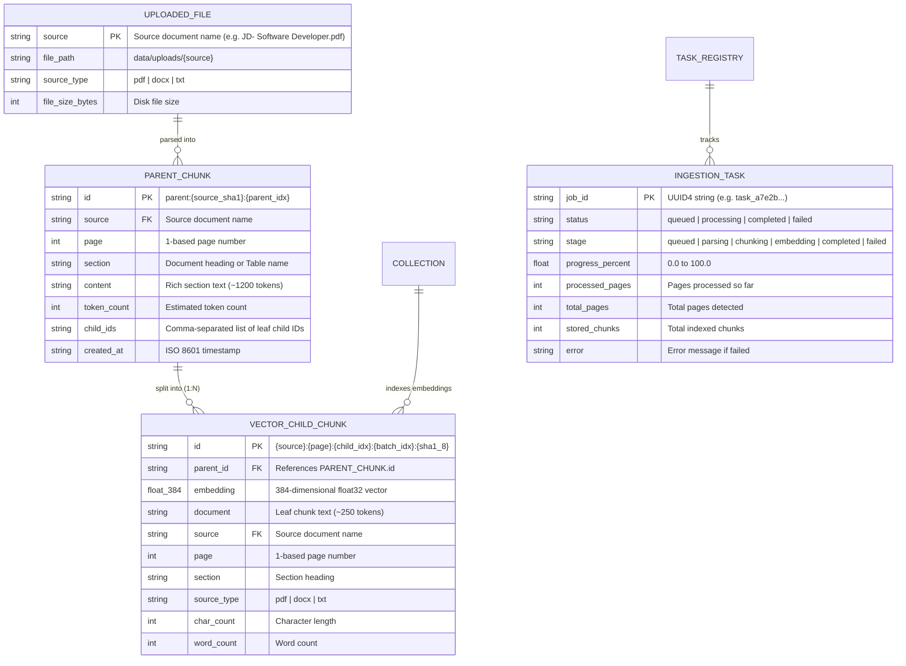

# Database & Storage Schema

The **AI Knowledge Assistant** uses a zero-cloud, dual-tier local persistent storage architecture combining **ChromaDB** (`data/chroma/`) for leaf vector embeddings and **SQLite** (`data/docstore.sqlite3`) for rich parent document chunks, alongside raw upload files (`data/uploads/`) and HuggingFace cached model weights (`data/hf_cache/`).

---

## 1. Dual-Storage Architecture & Entity Relationships



---

## 2. SQLite Parent Document Store (`data/docstore.sqlite3`)

The parent document store retains full 1200-token semantic sections, ensuring the LLM receives comprehensive context while vector retrieval operates on compact 250-token child chunks.

### Table: `parent_chunks`

```sql
CREATE TABLE IF NOT EXISTS parent_chunks (
    id TEXT PRIMARY KEY,
    source TEXT NOT NULL,
    page INTEGER,
    section TEXT,
    content TEXT NOT NULL,
    token_count INTEGER NOT NULL,
    child_ids TEXT NOT NULL,
    created_at TIMESTAMP DEFAULT CURRENT_TIMESTAMP
);

CREATE INDEX IF NOT EXISTS idx_parent_source ON parent_chunks (source);
```

| Column | Type | Description |
| :--- | :--- | :--- |
| `id` | `TEXT PRIMARY KEY` | Deterministic key: `parent:{source_hash}:{index}` |
| `source` | `TEXT NOT NULL` | Filename of the uploaded document |
| `page` | `INTEGER` | 1-based page number (or `NULL` if section spans multiple) |
| `section` | `TEXT` | Extracted section title, heading, or table name |
| `content` | `TEXT NOT NULL` | Verbatim text of parent section (including Markdown tables) |
| `token_count` | `INTEGER NOT NULL`| Word-based token estimate |
| `child_ids` | `TEXT NOT NULL` | JSON or comma-separated list of associated child vector IDs |
| `created_at` | `TIMESTAMP` | Record creation timestamp |

---

## 3. ChromaDB Leaf Vector Collection (`data/chroma/`)

Leaf chunks (~250 tokens) are indexed in ChromaDB for high-recall semantic vector search.

| Property | Value | Description |
| :--- | :--- | :--- |
| **Client Type** | `chromadb.PersistentClient` | Embedded SQLite + local HNSW binary segments |
| **Collection Name** | `ai_knowledge_assistant` | Default vector collection |
| **Embedding Model** | `all-MiniLM-L6-v2` | Sentence-Transformers 384-dimensional normalized embeddings |
| **Distance Metric** | `cosine` (`hnsw:space: cosine`) | Cosine distance $d \in [0, 2]$; similarity score $s = \max(0, 1 - d)$ |
| **Metadata Fields** | `source`, `page`, `section`, `parent_id`, `source_type`, `char_count`, `word_count` | Rich filtering metadata |

### Deterministic Leaf Chunk ID Format

Generated by `_build_chunk_id()` in `core/vector_store.py`:
```text
{source}:{page}:{chunk_index}:{batch_index}:{content_sha1_8}
```
**Example:**
```text
JD- Software Developer.pdf:1:1:1:a94f2c1b
```

---

## 4. In-Memory Task Registry Schema (`core/task_registry.py`)

Used for non-blocking asynchronous uploads, tracking batch progress across parsing, chunking, and vector embedding stages:

```python
@dataclass
class IngestionTask:
    job_id: str
    status: str            # 'queued' | 'processing' | 'completed' | 'failed'
    stage: str             # 'queued' | 'parsing' | 'chunking' | 'embedding' | 'completed' | 'failed'
    progress_percent: float # 0.0 to 100.0
    files: list[str]
    processed_pages: int = 0
    total_pages: int = 0
    stored_chunks: int = 0
    error: str | None = None
```

---

## 5. Storage Directory Layout

```text
data/
├── chroma/                  # ChromaDB SQLite metadata + HNSW index segments
│   ├── chroma.sqlite3
│   └── [uuid]/
│       ├── data_level0.bin
│       ├── header.bin
│       ├── length.bin
│       └── link_list.bin
├── docstore.sqlite3         # SQLite parent document store (ParentDocStore)
├── hf_cache/                # Cached sentence-transformers & cross-encoder weights
│   └── models--sentence-transformers--all-MiniLM-L6-v2/
└── uploads/                 # Persisted source files (.pdf, .docx, .txt)
    ├── JD- Software Developer.pdf
    └── JD - Data Quality Assurance.pdf
```
