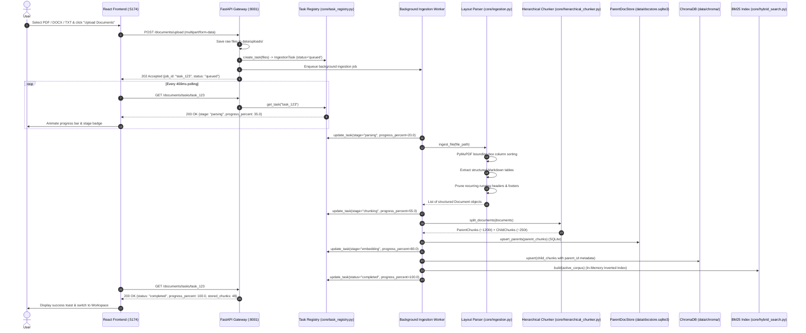
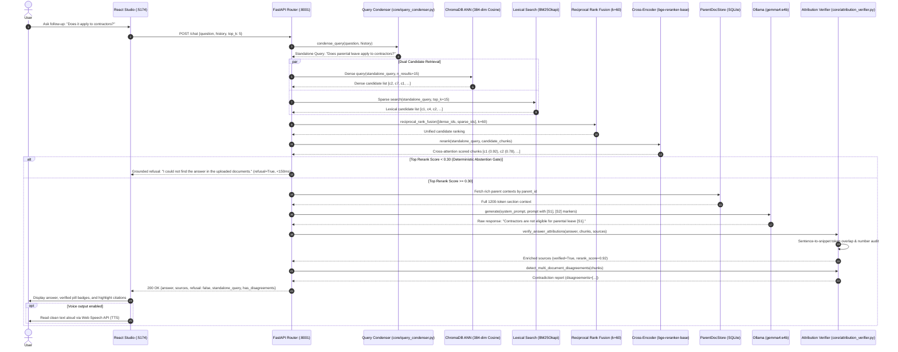

# End-to-End Data Flow

This document traces the complete lifecycle of data through the **AI Knowledge Assistant** across two primary production pipelines:
1. **Asynchronous Document Ingestion, Layout Parsing & Hierarchical Indexing Pipeline**
2. **Context-Aware Query Condensation, Two-Stage Hybrid Retrieval, Grounding & Verification Pipeline**

---

## 1. Asynchronous Document Ingestion Pipeline

When a user uploads files or triggers the sample document loader, the system decouples upload acceptance from heavy ingestion processing. A background worker streams pages, extracts Markdown tables, splits into parent/child chunks, and updates an in-memory task registry polled by the UI.

---

## 2. Grounded Conversational RAG Query & Attribution Pipeline

The query lifecycle solves the conversational pronoun problem, lexical blindness, and attribution fabrication through a 7-step pipeline:

