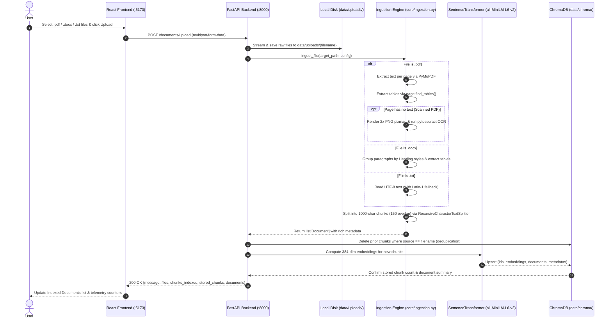
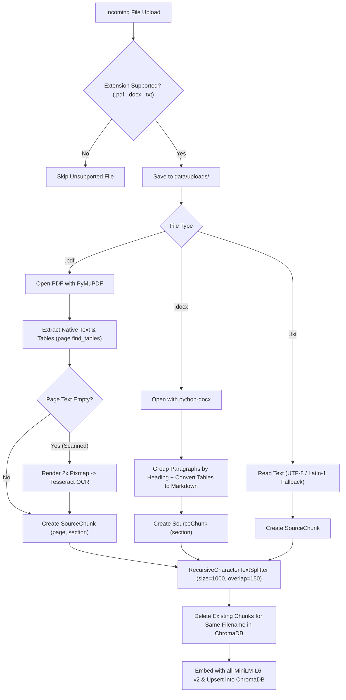
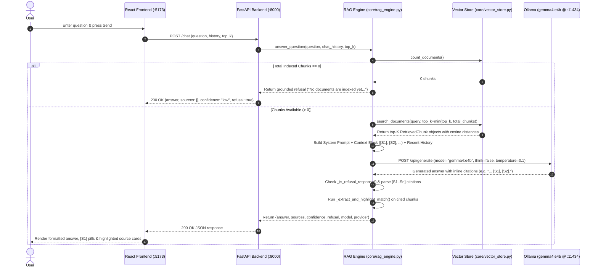
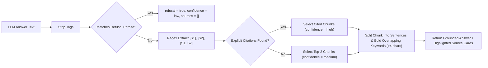

# End-to-End Data Flow

This document traces the complete lifecycle of data through the **AI Knowledge Assistant** across both primary pipelines:
1. **Document Ingestion & Vector Indexing Pipeline**
2. **Conversational RAG Query, Citation & Highlighting Pipeline**

---

## 1. Document Ingestion & Vector Indexing Pipeline

When a user uploads `.pdf`, `.docx`, or `.txt` files (or clicks **Load Sample PDFs**), the system executes a 6-stage pipeline that transforms raw files into 384-dimensional cosine-indexed vectors in local ChromaDB.

### Ingestion Decision Flow

---

## 2. Conversational Question Answering (RAG) Pipeline

When a user submits a question in the chat workspace, the backend retrieves the top-$K$ semantically matching chunks, constructs a strict citation-enforcing prompt, invokes `gemma4:e4b` on Ollama (or Gemini/Groq), and highlights the exact supporting sentences in the cited source chunks.

---

## 3. Post-Processing: Citation Parsing & Sentence Highlighting

A key differentiator of the RAG engine (`core/rag_engine.py`) is how it verifies and highlights source evidence after the LLM generates an answer:

