# Features, Architecture Fixes & Optimizations

This document catalogs the complete feature matrix of the **AI Knowledge Assistant**, detailing the 8 vertical production tickets, resolved architectural flaws, and Apple Silicon (`arm64`) optimizations.

---

## 1. Production Feature Matrix

```mermaid
flowchart LR
    subgraph Ingestion["1. Async & Layout-Aware Ingestion"]
        T1["TICK-001: Async Ingestion & Task Polling (HTTP 202)"]
        T2["TICK-002: PyMuPDF Layout & GFM Table Extraction"]
        T3["TICK-003: Hierarchical Chunking (250t / 1200t SQLite)"]
    end

    subgraph Retrieval["2. Hybrid Retrieval & Reranker"]
        T4["TICK-004: Hybrid Search (Dense + BM25Okapi + RRF k=60)"]
        T5["TICK-005: Cross-Encoder Reranking & Abstention (tau < 0.30)"]
        T6["TICK-006: Conversational Query Condensation Engine"]
    end

    subgraph Verification["3. Attribution & Multimodal UI"]
        T7["TICK-007: Sentence Entailment Judge & Multi-Doc Disagreements"]
        T8["TICK-008: Hands-Free Voice Layer (Web Speech STT / TTS)"]
    end

    Ingestion --> Retrieval --> Verification
```

### Detailed Feature Breakdown

| Ticket | Component | Problem Solved | Implementation Details |
| :--- | :--- | :--- | :--- |
| **TICK-001** | **Async Ingestion & Task Tracker** | Synchronous uploads blocked FastAPI event loop for 35+ seconds on large PDFs, causing 504 timeouts. | Returns HTTP 202 with `job_id` in <50ms. Background worker streams 10-page batches; `GET /documents/tasks/{job_id}` polls live progress percentage. |
| **TICK-002** | **Layout-Aware Table & Column Parser** | Naive text extractors interleaved text across multi-column pages and corrupted tables into whitespace soup. | PyMuPDF bounding-box clustering (`sort_blocks_by_column`), Markdown table formatter (`format_markdown_table`), and header/footer margin pruning. |
| **TICK-003** | **Hierarchical Parent-Child Dual Store** | Fixed 1000-char chunks forced a compromise: small chunks starved the LLM, large chunks diluted vector search. | Leaf child chunks (~250t) indexed in ChromaDB for high vector recall; rich parent sections (~1200t) in SQLite injected into LLM context. |
| **TICK-004** | **Hybrid Search & RRF ($k=60$)** | Pure vector cosine similarity was blind to exact alphanumeric codes, policy numbers, and acronyms. | Parallel dual retrieval: dense ChromaDB ANN + sparse tokenized `BM25Okapi` inverted index fused via Reciprocal Rank Fusion ($k=60$). |
| **TICK-005** | **Cross-Encoder & Abstention Gate** | Cosine similarity gave false-positive matches for out-of-scope questions, tempting LLMs to hallucinate. | Cross-attention scoring with `bge-reranker-base`. Deterministic fast-path returns immediate grounded refusal in <150ms when score $< 0.30$. |
| **TICK-006** | **Conversational Query Condensation** | Follow-up questions (*"Does it apply to contractors?"*) failed retrieval because raw pronouns missed context. | Few-shot context condenser rewriting conversational pronouns and ellipsis into standalone retrieval queries before hitting the index. |
| **TICK-007** | **Two-Tier Attribution & Disagreement** | LLMs hallucinated citations `[S1]` and arbitrarily picked between conflicting multi-document statements. | Post-generation sentence-level token & number entailment check (`verified: true/false`) + automated multi-doc contradiction reporting. |
| **TICK-008** | **Hands-Free Voice Layer (STT & TTS)** | Multi-tasking users needed speech input and audio responses without losing on-screen source cards. | Browser Web Speech API (`SpeechRecognition` + `SpeechSynthesis`). Cleans citation tags before speaking; interactive mic & read-aloud buttons. |

---

## 2. Architectural Flaws Identified & Resolved

| Component | Legacy Implementation | Production Fix |
| :--- | :--- | :--- |
| **Upload Processing** | Synchronous upload in HTTP handler; browser frozen until full file parsed & embedded. | Decoupled background execution with `TaskRegistry` and smooth client progress polling. |
| **Prompt Context Size** | Retrieved 100% of all chunks in the entire database whenever count > 4. | Capped retrieval to `desired_k` (default 5), hydrating rich parent sections without prompt overflow. |
| **Model Weight Reloading** | Instantiated PyTorch `SentenceTransformer` and `PersistentClient` on every single HTTP request. | Singletons managed via `@lru_cache`, cutting `/health` and search latencies from ~2.5s down to <15ms. |
| **Refusal Flagging** | Hardcoded `"refusal": False` even when model answered that info was missing. | Regex-based refusal pattern matcher + cross-encoder score threshold gating. |
| **Document Re-Uploads** | Uploading the same file generated duplicate chunks with differing batch indices. | Pre-upsert deduplication deleting prior chunks matching `where={"source": source_name}`. |
| **OCR Binary Availability** | `pytesseract` imported but `tesseract-ocr` missing in base Docker image. | Installed `tesseract-ocr` in Dockerfile and wrapped in graceful fallback exception handlers. |
| **Port Conflicts** | Defaulted to 8000 and 5173, colliding with NewsLens-AI containers. | Moved to dedicated non-conflicting ports: **8001** (Backend) and **5174** (Frontend). |

---

## 3. Apple Silicon (`arm64`) & Ollama (`gemma4:e4b`) Performance

1. **Native Metal GPU Acceleration**:
   - `gemma4:e4b` operates on macOS Metal GPU unified memory, sustaining ~38 tokens/second without thermal throttling.
2. **Persistent Memory Retention**:
   - Ollama session configured with `"keep_alive": "30m"`, keeping weights warm across multi-turn user queries.
3. **Deterministic Sampling**:
   - Configured with `temperature: 0.1` and `think: False` for rapid, consistent, evidence-bound RAG completions.
4. **Sub-150ms Abstention**:
   - Out-of-scope questions bypass the LLM completely via the reranker threshold gate, saving GPU compute.
